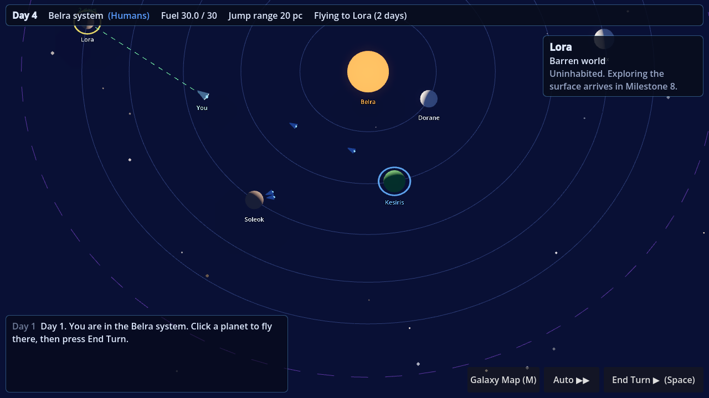
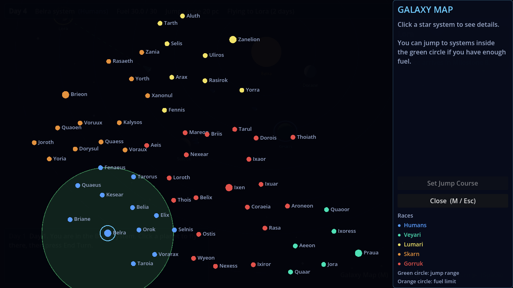

# Project Ranger (working title)

A Godot 4 space game. Space is turn-based and isometric, with trading, combat and missions inspired by *Space Rangers 2*. Planets are first-person open worlds with exploration, survival and crafting inspired by *No Man's Sky*. It's planned for 8–16 player multiplayer, with a story about an invading machine race, the Ascendancy.

**Design:** [`docs/MASTER_DESIGN.md`](docs/MASTER_DESIGN.md) is the single source of truth for what the game will be.

## Status

| Milestone | State |
|---|---|
| M0: project setup, core systems, tests, CI | ✅ Done |
| M1: galaxy generation, isometric space view, turns, hyperspace jumps | ✅ Done (first playable) |
| M2: trading | Next |

## How to play the current build

1. Install **Godot 4.7** (standard version, not .NET) from https://godotengine.org/download.
2. Download this repository. With GitHub Desktop: *File → Clone repository*. To get updates later, press *Fetch origin / Pull*.
3. Open Godot, click **Import**, and pick the `project.godot` file in this folder.
4. Press **F5** (or the ▶ Play button, top right) to run the game.

### Controls (space)

| Action | Control |
|---|---|
| Fly to a planet / point | Left click |
| End turn (everything moves at once) | **Space** or the *End Turn* button |
| Auto: keep ending turns until you arrive | **Shift+Space** or *Auto ▶▶* |
| Galaxy map (pick a system, set jump course) | **M** |
| Move camera | Right-drag, or WASD / arrow keys |
| Zoom | Mouse wheel |
| Center on your ship | **F** |
| Menu (save / load / quit) | **Esc** |

## For developers (and AI assistants)

See [`AGENTS.md`](AGENTS.md) for project layout, conventions, and how to run the tests.
