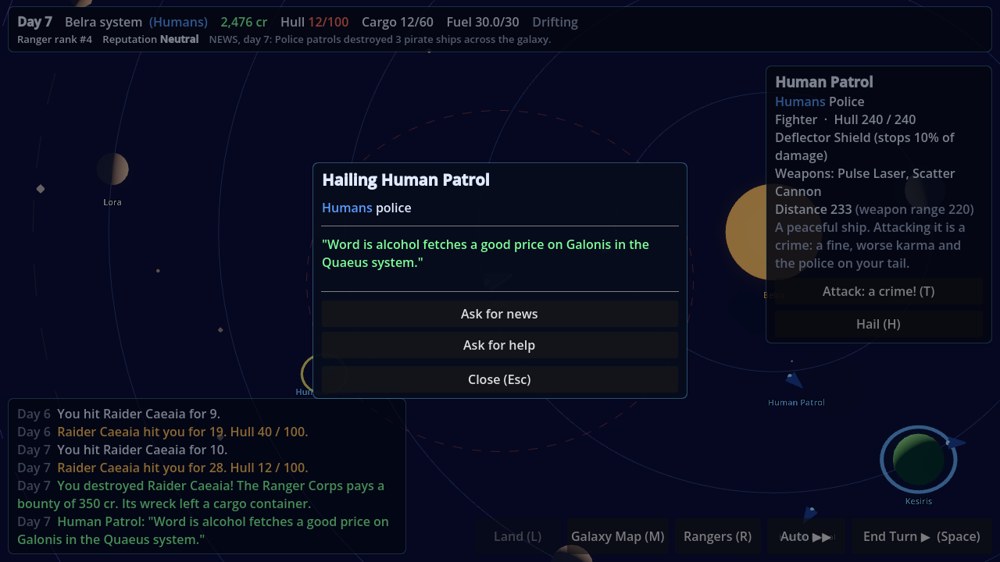
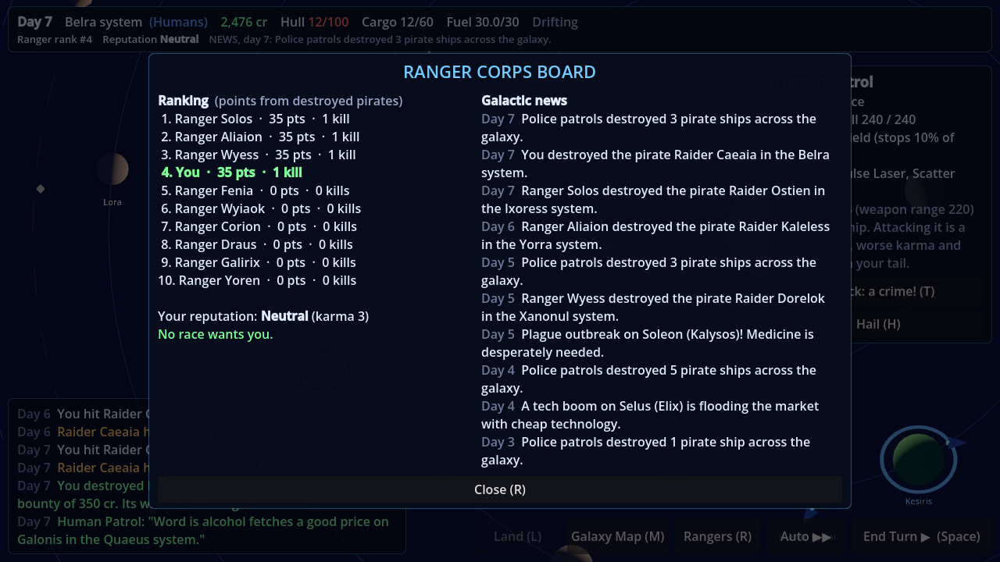
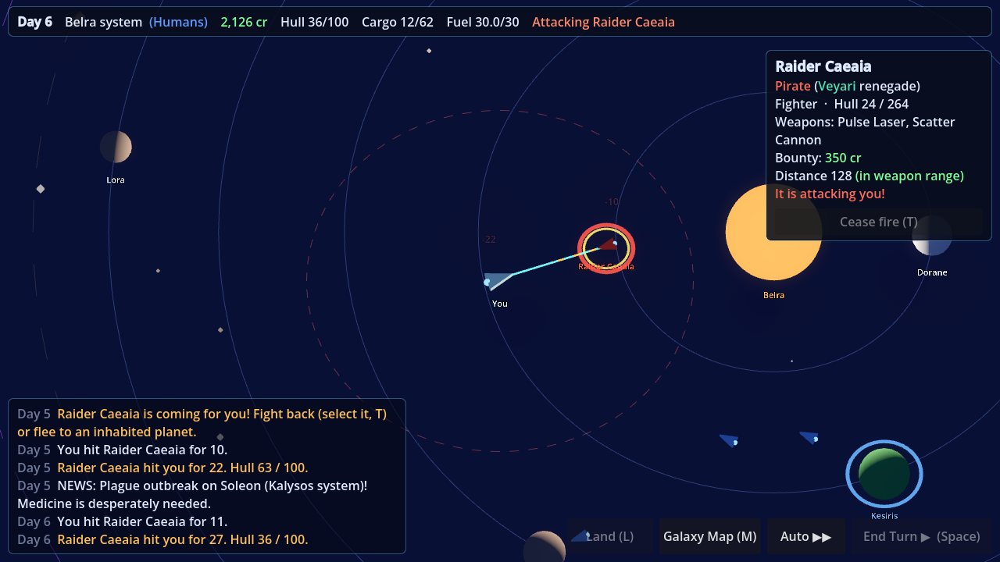
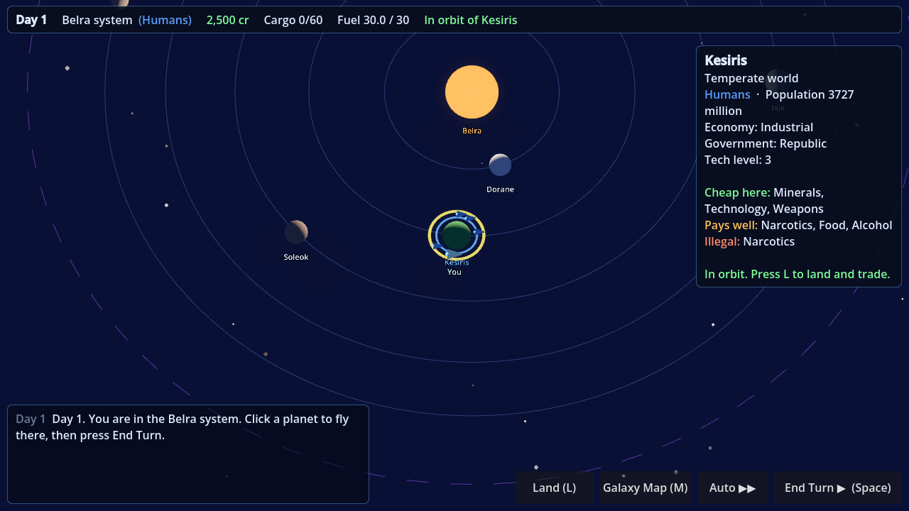
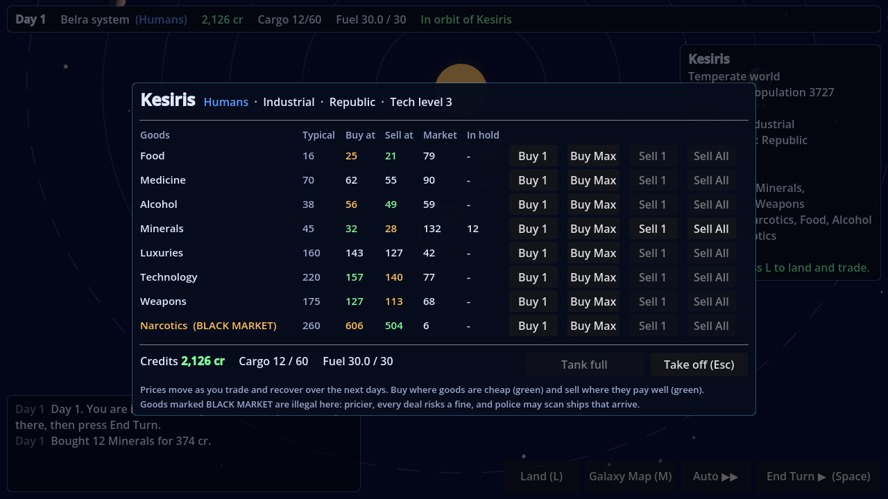
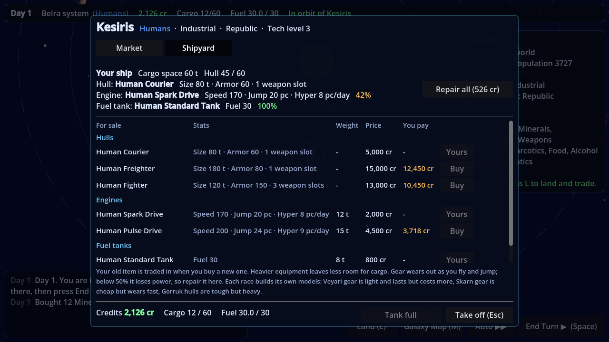

# Project Ranger (working title)

A Godot 4 space game. Space is turn-based and isometric, with trading, combat and missions inspired by *Space Rangers 2*. Planets are first-person open worlds with exploration, survival and crafting inspired by *No Man's Sky*. It's planned for 8–16 player multiplayer, with a story about an invading machine race, the Ascendancy.

**Design:** [`docs/MASTER_DESIGN.md`](docs/MASTER_DESIGN.md) is the single source of truth for what the game will be.

## Status

| Milestone | State |
|---|---|
| M0: project setup, core systems, tests, CI | ✅ Done |
| M1: galaxy generation, isometric space view, turns, hyperspace jumps | ✅ Done (first playable) |
| M2: trading (markets, supply and demand, contraband, black market, fuel costs) | ✅ Done |
| M3: ships and gear (shipyard, hulls, engines, fuel tanks, weight vs cargo, wear and repair) | ✅ Done |
| M4: space combat (weapons, pirates, bounties, loot, gripper, asteroids) | ✅ Done |
| M5: living galaxy (NPC traders, police and rangers; shields and radar; crimes and karma; hailing; news) | ✅ Done |
| M6: the Ascendancy war (invasions, liberations, cores, Ranger Hub) | Next |

## How to play the current build

1. Install **Godot 4.7** (standard version, not .NET) from https://godotengine.org/download.
2. Download this repository. With GitHub Desktop: *File → Clone repository*. To get updates later, press *Fetch origin / Pull*.
3. Open Godot, click **Import**, and pick the `project.godot` file in this folder.
4. Press **F5** (or the ▶ Play button, top right) to run the game.

### Controls (space)

| Action | Control |
|---|---|
| Fly to a planet / point / cargo container | Left click |
| Look at a ship or asteroid | Left click on it |
| Attack the selected ship or asteroid / cease fire | **T** or the button in the info panel |
| Hail (talk to) the selected ship or planet | **H** or *Hail* |
| Ranger Corps board (ranking, reputation, news) | **R** or *Rangers* |
| End turn (everything moves at once) | **Space** or the *End Turn* button |
| Auto: keep ending turns until you arrive | **Shift+Space** or *Auto ▶▶* |
| Galaxy map (pick a system, set jump course) | **M** |
| Land on the planet you orbit (trade, refuel, shipyard) | **L** or *Land* |
| Move camera | Right-drag, or WASD / arrow keys |
| Zoom | Mouse wheel |
| Center on your ship | **F** |
| Menu (save / load / quit) | **Esc** |

### Making money

You start with 2,500 cr and an empty 60-ton hold. Click a planet to see what's cheap there and what pays well. Fly to an inhabited one and press **L** to land. Buy goods where they're cheap (green buy price) and sell them where they pay well (green sell price). Farm worlds make food, industrial worlds make technology and minerals, and events like famines and plagues send prices soaring. Every trade moves the price, so a route stops paying if you farm it. Goods marked *BLACK MARKET* are illegal on that planet: they pay more, but police may catch you. Fuel costs money now, so keep some credits for it.

### Upgrading your ship

When you land, open the **Shipyard** tab. Each planet sells hulls, engines, fuel tanks, grippers, radars, shields and weapons built by its own race, and higher tech worlds sell better models. Your old item is traded in, so you only pay the difference. A bigger hull means more cargo space. A better engine flies faster, jumps farther and spends fewer days in hyperspace, but it is heavier and takes some cargo space. A bigger fuel tank lets you make longer trips. Your engine and tank wear out as you fly and jump. Below 50% they lose power, so press **Repair all** now and then (the HUD's *Your ship* panel shows their condition).

### Fighting pirates

Pirates are the red ships with names. They stay away from the races' home systems and get more common and tougher the farther out you fly. When one spots you, the log warns you and Auto stops. You can run to an inhabited planet (ships in orbit there are protected by its defenses) or fight: click the pirate and press **T** (*Attack*). Your ship chases it and fires every turn it is in range (the dashed red circle). Destroying a pirate earns a bounty from the Ranger Corps and leaves a yellow cargo container. Fly close and your gripper picks it up. You can also shoot asteroids for minerals. Buy better weapons in the **Shipyard**: energy weapons are all-rounders, fragment cannons hit groups, and missiles hit hardest from far away but need reloading (*Repair all* reloads them). If your ship is destroyed, the Ranger Corps tows you to a planet for 20% of your credits, and your cargo stays behind in a container. A **shield** (Shipyard) stops part of every hit.

### A living galaxy

You are not alone out there. **Traders** (the color of their race) fly between planets buying and selling, which moves prices just like your trades do. **Police** (blue) guard the inhabited planets and attack pirates that come close, so the space near planets is safer than the open space between them. **Rangers** (green) roam the galaxy hunting pirates for bounties, and the **Ranger Corps board** (**R**) ranks you against them. You only see ships within your **radar** range (the faint blue circle). A better radar from the Shipyard lets you see farther.

Select a ship or an inhabited planet and press **H** to **hail** it. Ask for news and price tips, ask police or rangers to help you fight the pirate you are attacking, bribe or threaten a pirate, or surrender some cargo to make it leave you alone. Each race reacts in its own way: Skarn are greedy, Gorruk are brave, Veyari and Lumari are helpful.

You can attack peaceful ships too, or hail a trader and demand its cargo, but that is a crime. Your **reputation** drops, and if the system has a government, its race fines you and you become **WANTED**: their police hunt you, and their planets won't trade with you or protect you. Hail one of their planets to pay the fine (fines also fade slowly). Destroying pirates improves your reputation. The status bar shows your reputation, your fines and the latest galactic news.

## For developers (and AI assistants)

See [`AGENTS.md`](AGENTS.md) for project layout, conventions, and how to run the tests.
